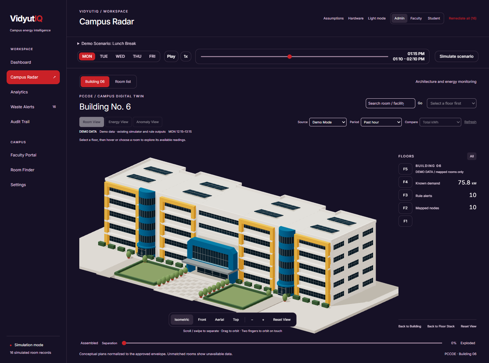
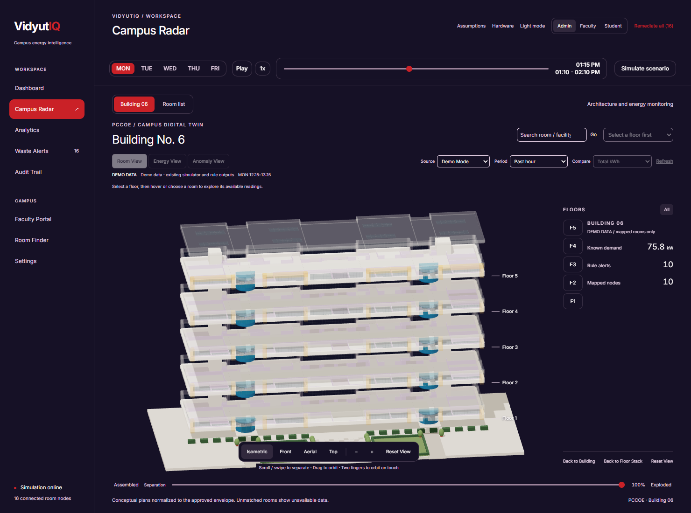
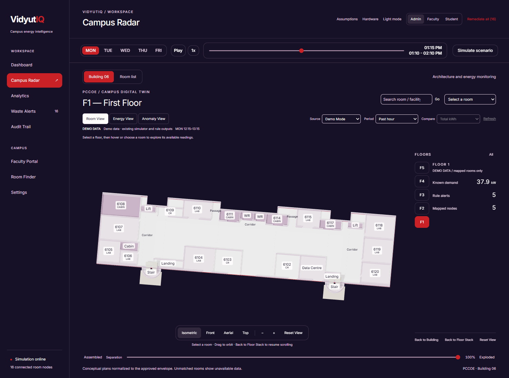
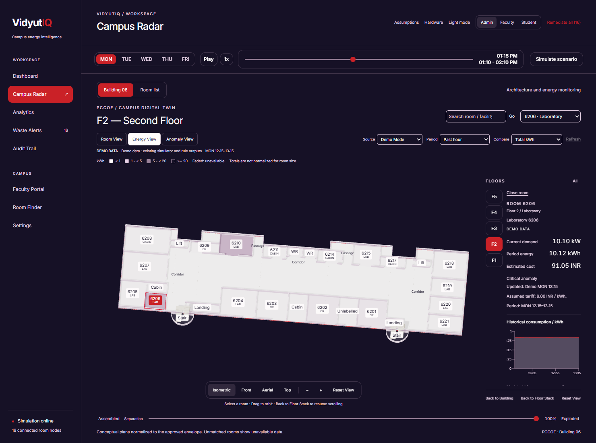
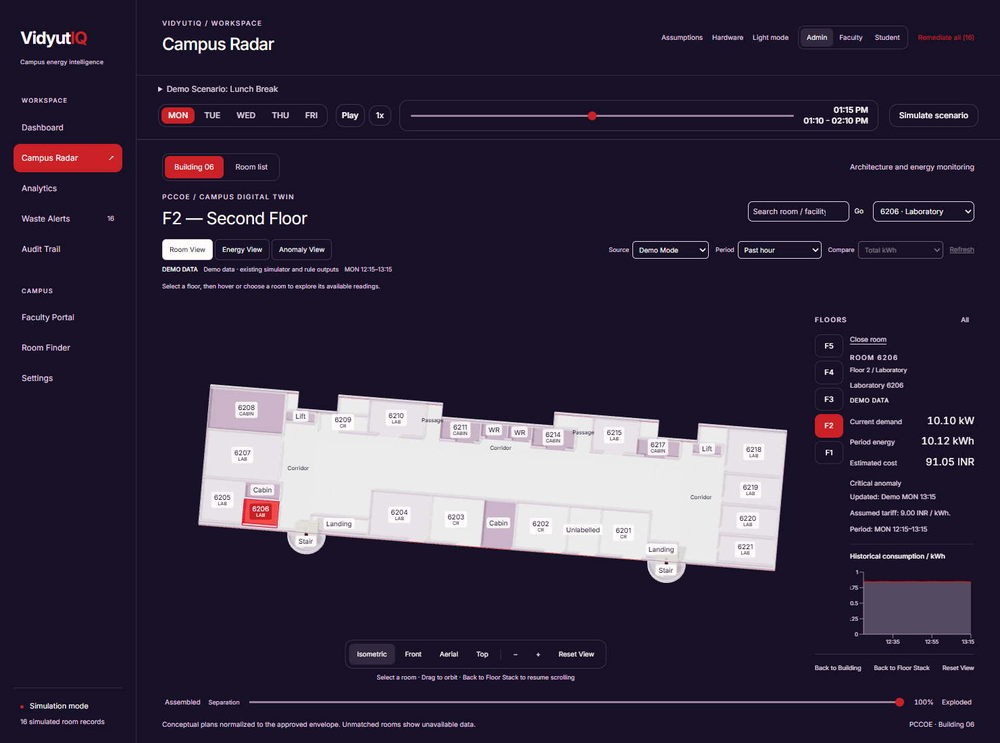
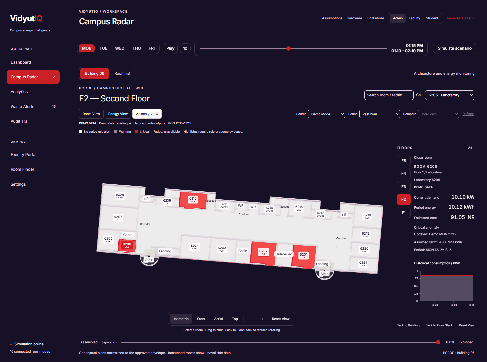
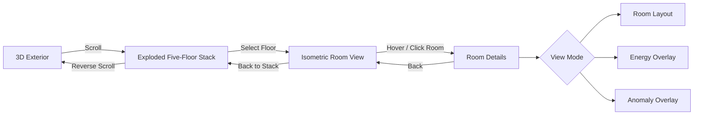
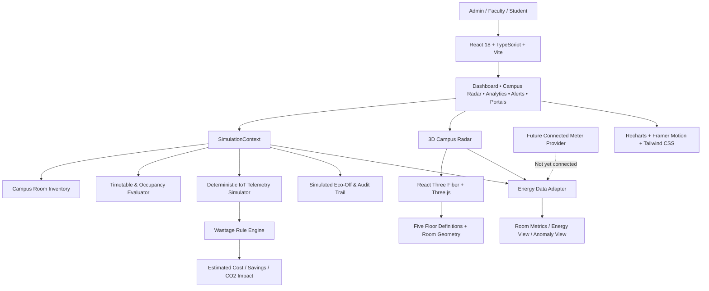

<div align="center">

# ⚡ VidyutIQ
### Campus Energy Intelligence & Interactive 3D Digital Twin

**See where electricity is used. Understand where it is wasted. Explore what can be saved.**

[](https://react.dev/)
[](https://www.typescriptlang.org/)
[](https://vite.dev/)
[](https://threejs.org/)
[](https://r3f.docs.pmnd.rs/)
[](https://tailwindcss.com/)
[](#-implementation-status--limitations)

[**Explore Campus Radar**](#-campus-radar--the-3d-digital-twin) · [**Quick Start**](#-quick-start) · [**Architecture**](#-system-architecture) · [**Screenshots**](#-interface-preview) · [**Roadmap**](#-future-scope)

</div>

---

## 📌 Problem Statement & Real-World Impact

A university can have hundreds of classrooms, laboratories, and shared spaces—yet limited visibility into **which rooms need electricity at any given moment**.

A timetable says a room is vacant, but its lights, fans, air conditioners, or computers may still be running. A cancelled lecture can leave equipment powered on. A laboratory may keep drawing standby energy long after a practical session ends. Without room-level context, administrators see electricity bills and aggregate consumption figures but cannot easily answer **where avoidable demand originates**.

The problem is not simply monitoring watts. It is connecting **electricity consumption, scheduled occupancy, room activity, and operational decisions** in one understandable system.

> **VidyutIQ turns campus energy data into actionable room-level intelligence—then places that intelligence inside an explorable 3D model of the campus.**

### What VidyutIQ aims to improve

- **Visibility:** Understand energy demand at campus, building, floor, and room level.
- **Waste detection:** Flag powered equipment during scheduled breaks, cancelled classes, and unoccupied periods.
- **Actionability:** Inspect the evidence and preview an Eco-Off response instead of relying on aggregate dashboards alone.
- **Accountability:** Trace simulated interventions, avoided energy, estimated costs, and the assumptions behind each projection.
- **Usability:** Give administrators, faculty, and students workflows that reflect their different needs.

**Current maturity:** VidyutIQ is an interactive **software prototype with a deterministic IoT/energy simulator**. The room-level 3D experience is implemented; real IoT measurements and physical actuation are not yet connected. See [Implementation Status](#-implementation-status--limitations).

---

## 🖥️ Interface Preview

The screenshots below are checked into the repository under `Frontend/docs/verification/`.

### Complete building → Five-floor explosion

| Full Building | Exploded Building |
|:---:|:---:|
|  |  |

### Inspect a floor → Analyze electricity use

| Floor 1 — Room View | Energy View |
|:---:|:---:|
|  |  |

### Select a room → Investigate anomalies

| Room Details | Anomaly View |
|:---:|:---:|
|  |  |

For the full screenshot gallery and verification notes, see [`Frontend/docs/verification/README.md`](Frontend/docs/verification/README.md).

---

## 🚀 Key Features

### 🏢 1. Campus Radar — The 3D Digital Twin

The signature feature of VidyutIQ is an interactive reconstruction of **PCCOE Building No. 6**, built from five supplied floor-plan images and architectural exterior references.

- **Recognizable 3D exterior:** Cream/white facade, orange framing, a larger blue central entrance, two curved blue staircase towers, landscaping, and pathways.
- **Scroll-driven floor explosion:** Start with the assembled building and progressively separate it into **five individually modeled floor layers**. Reverse scroll to reassemble it.
- **Fixed application controls:** The floor animation changes the 3D scene while the surrounding navigation and controls remain usable.
- **Cinematic floor selection:** Select a floor to transition into a slightly tilted, roofless, isometric room view.
- **Actual floor-specific layouts:** Independently authored room boundaries, labels, corridors, lifts, stairs, cabins, classrooms, labs, washrooms, and known merged spaces.
- **Interactive room selection:** Hover/select rooms to inspect labels, availability of mapped readings, and room-level details.
- **Three analytical modes:** **Room View**, **Energy View**, and **Anomaly View**.
- **Search and accessible fallback:** Room search and a non-3D list provide an alternative to WebGL exploration.

The geometry is a **visual reconstruction from conceptual references**, not an engineering-grade CAD/BIM model. Room numbering and telemetry mapping are maintained separately to prevent geometry from implying nonexistent metering.

### ⚡ 2. Energy Monitoring Dashboard

- Campus-wide simulated instantaneous demand (**kW**).
- Connected *simulation-node* and scheduled-occupancy summaries.
- Current waste alerts and avoidable-power estimates.
- Estimated energy savings (**kWh**) and cost impact (**₹**).
- Actual-versus-optimized **illustrative** energy curve.
- Department-level consumption visualizations and comparisons.
- Adjustable model assumptions for tariffs, emissions, and projected impact.

The dashboard labels its readings as **simulated**, not live measurements.

### 🚨 3. Context-Aware Wastage Detection

The rule engine evaluates electricity demand against timetable occupancy and simulated presence information. Its implemented scenarios include:

| Scenario | Why it matters | Prototype response |
|---|---|---|
| **Break-hour consumption** | Equipment remains on during a scheduled break | Flag excess active load and estimate hourly cost |
| **Cancelled lecture** | A vacant room may keep consuming power | Detect load despite cancellation and recommend Eco-Off |
| **Unscheduled vacant room** | Computers, AC, or lights draw power unnecessarily | Identify potential ghost loads using simulated presence |
| **Scheduled but empty room** | Timetable and presence signals disagree | Surface a warning for review |
| **Normal occupied session** | Consumption may be justified | Avoid treating all active loads as waste |

Severity, reasons, and recommended actions are produced by the local rules. The separate **AI anomaly preview** is an explanatory simulation; it is **not a deployed, trained ML model or hosted LLM**.

### 🕒 4. Timetable-Aware Simulation

VidyutIQ simulates a campus day against normalized PCCOE-inspired timetable entries.

- Select a weekday and a simulated time.
- Play or pause the clock and adjust playback speed.
- Explore scheduled lectures, lunch breaks, cancellations, and vacant rooms.
- Trigger representative scenarios such as **Lunch Break**, **Teacher Cancellation**, **Idle Lab**, **Normal Class**, and **After Hours**.
- Watch the energy and alert displays update coherently from shared application state.

The repository contains original timetable CSV references, while the running frontend currently uses a **normalized in-code schedule** rather than importing those CSV files dynamically at runtime.

### 🛑 5. Eco-Off Remediation Simulator

The prototype lets users preview the effect of reducing unnecessary appliance loads:

- Simulated room-level appliance switching.
- **Eco-Off** actions for selected rooms.
- Campus-wide remediation scenario.
- Estimated watts curtailed, energy saved, cost reduction, and avoided emissions.
- Recorded actions in an **audit trail**.

**Safety boundary:** These actions operate on application simulation state. The current repo does **not** send commands to a real relay, contactor, or building electrical panel.

### 👩‍🏫 6. Faculty Portal & Student Room Finder

**Faculty Portal:** Explore an assigned teaching schedule, simulate lecture cancellations, restore classes, and observe associated room availability and wastage implications.

**Student Room Finder:** Search available classrooms and laboratories, with filters for building, room type, air conditioning, projector availability, and room name/number. Availability is based on the current **simulated timetable state**.

### 📊 7. Analytics, Auditability & Hardware Planning

- Energy consumption and estimated-impact cards.
- Department leaderboard and hourly energy chart.
- Alert triage and room inspection.
- Audit log of simulated interventions.
- Configurable assumptions and scenario presets.
- A **hardware bill of materials (BOM)** for a potential ESP32-based metering/automation pilot.

---

## 🧭 How Campus Radar Works



**The user journey is spatial:** building → floor → room → energy evidence → decision. Scrolling changes the building model, not the dashboard's navigation layout.

---

## 🏗️ System Architecture



### Core design principles

1. **One shared simulation state:** Room status, occupancy, electricity models, alerts, and controls derive from common state.
2. **Geometry is not telemetry:** A room appearing on the floor plan does not mean it has an energy meter or simulated node.
3. **Simulation is explicitly labeled:** Modeled history and demo appliance estimates are never presented as measured data.
4. **No fake live fallback:** The 3D energy adapter supports a future connected provider contract; unavailable readings remain unavailable until implemented.
5. **Separation of concerns:** Architecture, camera transitions, room metadata, analytics, and DOM UI are maintained in separate modules.

For implementation details, see the [Campus Radar developer guide](Frontend/docs/campus-radar-developer-guide.md).

---

## 🧰 Technology Stack

| Layer | Technology | Purpose |
|---|---|---|
| Frontend | **React 18**, **TypeScript**, **Vite 6** | Interactive single-page dashboard |
| UI styling | **Tailwind CSS 3**, custom CSS | Responsive midnight-violet interface |
| UI animation | **Framer Motion** | Panels, navigation, and transitions |
| 3D renderer | **Three.js 0.170**, **React Three Fiber 8.18** | Building geometry, camera, picking, floor explosion |
| Visualization | **Recharts** | Energy, comparison, and impact charts |
| Icons | **Lucide React** | Consistent interface iconography |
| Application state | **React Context** | Shared timetable, simulation, and room state |
| Energy intelligence | **TypeScript rule engine** | Occupancy-aware wastage checks |
| Data source (current) | **Deterministic frontend simulator** | Demonstrable room-level telemetry and scenarios |
| Real backend / meter API | **Not connected** | Future deployment milestone |

### Brand palette

The project uses a restrained visual identity: midnight violet background (`#161126`), off-white (`#FFFCFC`), soft lavender (`#E6D1E5`), muted violet (`#9B829A`), and signal red (`#CA2127`). The 3D exterior retains the source building's physical blue, orange, and cream colors.

---

## 📂 Repository Structure

```text
Vidyut_IQ/
├── Frontend/                          # Current full 3D-enabled Vite application
│   ├── src/
│   │   ├── App.tsx                    # Main navigation and layout
│   │   ├── components/
│   │   │   ├── dashboard/             # Executive overview
│   │   │   ├── radar/
│   │   │   │   ├── building/          # 3D scene, geometry, cameras and floor plans
│   │   │   │   │   └── plans/         # floor1.ts ... floor5.ts
│   │   │   │   └── energy/            # Demo/connected adapters and overlays
│   │   │   ├── analytics/             # Charts and projected impact
│   │   │   ├── alerts/                # Triage and audit trail
│   │   │   ├── student/               # Available room finder
│   │   │   ├── teacher/               # Schedule and cancellation
│   │   │   └── layout/                # Sidebar, header, simulation bar
│   │   ├── context/SimulationContext.tsx
│   │   ├── data/campusRooms.ts
│   │   ├── services/
│   │   │   ├── iotSimulator.ts
│   │   │   ├── timetableParser.ts
│   │   │   ├── wastageEngine.ts
│   │   │   └── aiAnomalyPreview.ts
│   │   └── config/                    # Hardware BOM and assumptions
│   ├── docs/                          # Development notes and verified screenshots
│   │   └── verification/
│   ├── tests/                         # Camera, floor, energy and explosion tests
│   ├── scripts/verify-campus-radar.mjs
│   ├── package.json
│   └── README.md
├── 3D_view_reference_images/          # Five floor drawings + facade references
├── time tables csv/                  # Timetable source/reference CSV files
├── core.md/                          # Earlier concept and architecture design docs
├── skills/                            # Optional coding/design skill references
├── SKILL.md                           # Spatial 3D interface guidance
├── src/                               # Preserved earlier frontend version
├── package.json                       # Earlier root Vite app
└── README.md                          # Project overview (this file)
```

> **Which application should I run?** Use **`Frontend/`** for the latest 3D Campus Radar experience. The root-level `src/` and `package.json` represent an earlier frontend implementation preserved in the repository.

---

## ⚡ Quick Start

### Prerequisites

- A recent **Node.js LTS** release and npm.
- A modern browser with WebGL support for the 3D mode.
- Git (optional if downloading the repository as ZIP).

### 1. Clone the repository

```bash
git clone https://github.com/matpat07/Vidyut_IQ.git
cd Vidyut_IQ/Frontend
```

### 2. Install packages

```bash
npm ci
```

### 3. Run the development server

```bash
npm run dev
```

Open the local address printed by Vite (commonly `http://localhost:5173`).

**Windows PowerShell:** If PowerShell blocks `npm.ps1`, use `npm.cmd ci`, `npm.cmd run dev`, and analogous `npm.cmd` commands rather than changing your system's execution policy.

### 4. Run tests and production checks

```bash
npm test
npm exec tsc -- --noEmit
npm run build
npm run preview
```

### 5. Optional browser audit

```bash
npm run verify:radar
```

This last command requires compatible browser automation tooling and a Chrome executable already available in the environment. It does **not** install a browser. Setup and environment variables are documented in [`Frontend/docs/campus-radar-developer-guide.md`](Frontend/docs/campus-radar-developer-guide.md).

---

## 🎬 Recommended Demo Workflow

The UI starts at an illustrative **Monday, 1:15 PM** state, placing the simulation in the scheduled lunch break so the wastage rules can be demonstrated quickly.

1. **Open Dashboard:** Identify simulated total demand, occupied rooms, active alerts, and projected savings.
2. **Open Campus Radar:** Inspect the assembled PCCOE Building No. 6 in the 3D viewport.
3. **Scroll to explode:** Separate the five floors while the navigation remains stationary.
4. **Choose a floor:** Select Floor 1 or Floor 4 to inspect its distinct modeled room arrangement.
5. **Select a room:** Hover or click a room with supported simulation mapping to see its energy detail. Unmapped spaces clearly show that data is unavailable.
6. **Change view mode:** Compare **Room**, **Energy**, and **Anomaly** overlays.
7. **Change the scenario:** Use the global simulation clock or preset scenarios to show how scheduled occupancy changes the alert logic.
8. **Inspect remediation:** Apply an **Eco-Off simulation** and compare avoidable draw, estimated savings, and recorded audit entries.
9. **Switch roles:** Demonstrate the faculty cancellation portal and student room finder.

All readings in this walkthrough are **simulated examples**; the demo does not actuate electrical hardware.

---

## 📐 Energy Logic & Impact Estimation

VidyutIQ models several related—but distinct—quantities:

| Metric | Unit | Meaning |
|---|---|---|
| Instantaneous demand | **kW** | Power at a specific point in simulated time |
| Electricity consumption | **kWh** | Energy over a selected period |
| Avoidable demand | **W / kW** | Rule-derived excess demand relative to modeled standby |
| Estimated cost | **₹** | Modeled kWh × configured tariff (₹/kWh) |
| Estimated emissions avoided | **kg CO₂** | Modeled kWh saved × configured grid factor |

The demo history integrates deterministic power samples over time. It is **modeled history**, not a historical sensor recording. Appliance breakdowns use configured device counts and rated wattages unless a real provider later supplies measured submeter data.

The current implementation includes a [configurable hardware BOM](Frontend/src/config/hardwareBOM.ts) covering an **ESP32 DevKit**, **PZEM-004T energy meter**, **relay/contactor interface**, **LD2410C presence sensor**, **BME280 environmental sensor**, power supply, and enclosure. These are proposed pilot components, **not evidence that the devices are installed or communicating with the dashboard**.

> **Electrical safety:** Any future control of mains-powered appliances requires appropriately rated hardware, occupant-safety logic, and installation by a qualified electrician. The present Eco-Off button is a software simulation.

---

## ✅ Implementation Status & Limitations

| Capability | Current state |
|---|---|
| React dashboard, analytics, alert triage and simulation controls | ✅ Implemented |
| Faculty schedule/cancellation simulation and student room finder | ✅ Implemented |
| Five-floor, selectable 3D Building 6 model | ✅ Implemented |
| Scroll-driven floor separation and room-level interactions | ✅ Implemented |
| Room / Energy / Anomaly overlays | ✅ Implemented using available demo data |
| Automated tests and recorded browser verification screenshots | ✅ Present in repository |
| Simulated energy telemetry, savings and audit logs | ✅ Implemented |
| Real IoT meter / MQTT / backend data integration | 🔜 Not connected |
| Actual measured room-level energy history | 🔜 Not available |
| Physical relay/contactor automation | 🔜 Not implemented |
| Deployed, trained ML anomaly detection model | 🔜 Not implemented |
| Survey-grade building CAD model | ❌ Not claimed; geometry is conceptual |

**Coverage note:** The 3D building contains many rooms that are not represented by the simulator's **16 campus-wide room records**. Only compatible, verified room mappings receive demo energy data. Other rooms—and source/plan conflicts—show explicit unavailable states. A 3D room is not the same thing as a connected sensor node.

**Verification note:** Browser screenshots and automated tests are available in the repository, but their software-rendered results do not establish performance or accessibility across every physical device. See the [verification report](Frontend/docs/verification/README.md).

---

## 🗺️ Future Scope

- **IoT pilot:** Connect calibrated energy meters and occupancy sensors in a small number of representative classrooms and laboratories.
- **Secure connected-data ingestion:** Add an authenticated telemetry service and map real device IDs to verified room identifiers.
- **Human-in-the-loop automation:** Introduce reviewed, safety-gated control decisions before any physical switching.
- **Measured impact validation:** Compare verified energy baselines with post-intervention readings; report uncertainty and real tariffs.
- **Predictive intelligence:** Evaluate learned anomaly models only after obtaining representative labeled sensor data.
- **Campus-wide expansion:** Extend accurate 3D and room mapping to additional buildings with validated architectural information.
- **Operational reporting:** Export energy, costs, anomalies, and intervention histories for campus sustainability teams.

---

## 📚 Documentation

- [3D Campus Radar developer guide](Frontend/docs/campus-radar-developer-guide.md)
- [Campus Radar browser verification and gallery](Frontend/docs/verification/README.md)
- [Camera, accessibility and performance notes](Frontend/docs/campus-radar-phases-9-11.md)
- [Reference floor plans and building views](3D_view_reference_images/)
- [Architecture planning notes (historical/aspirational)](core.md/architecture.md)
- [Hardware bill of materials](Frontend/src/config/hardwareBOM.ts)

The historical `core.md/` documents discuss a broader classroom-availability platform and an aspirational backend. **Those plans are not a description of an implemented Next.js/Supabase backend in the current VidyutIQ frontend.**

---

## 🤝 Contributors & Collaboration

VidyutIQ is developed as a campus-energy intelligence prototype. See the [GitHub contributors page](https://github.com/matpat07/Vidyut_IQ/graphs/contributors) for contributors reflected in repository history.

For changes, keep the existing project structure, preserve the five independent floor definitions, run the frontend checks, and clearly distinguish simulation outputs from real-world measurements. Issues and pull requests can be opened through the [repository](https://github.com/matpat07/Vidyut_IQ).

---

## 📜 License

**No `LICENSE` file is currently present in the repository.** Please confirm and add the intended license before representing VidyutIQ as MIT-licensed or otherwise open-source for reuse. The use of open-source dependencies does not automatically license this project's own code.

---

<div align="center">

### ⚡ VidyutIQ — Know the load. Find the waste. Save the energy.

**Built around a simple idea: a smarter campus starts with knowing what happens in every room.**

</div>
