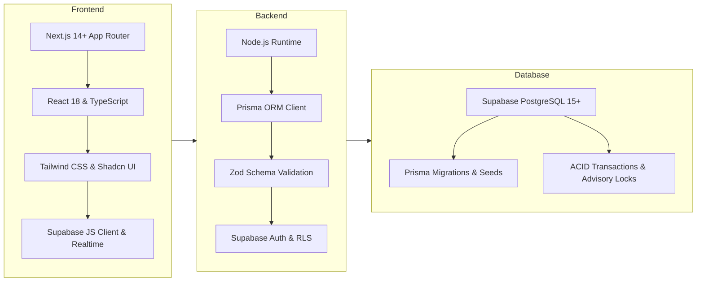
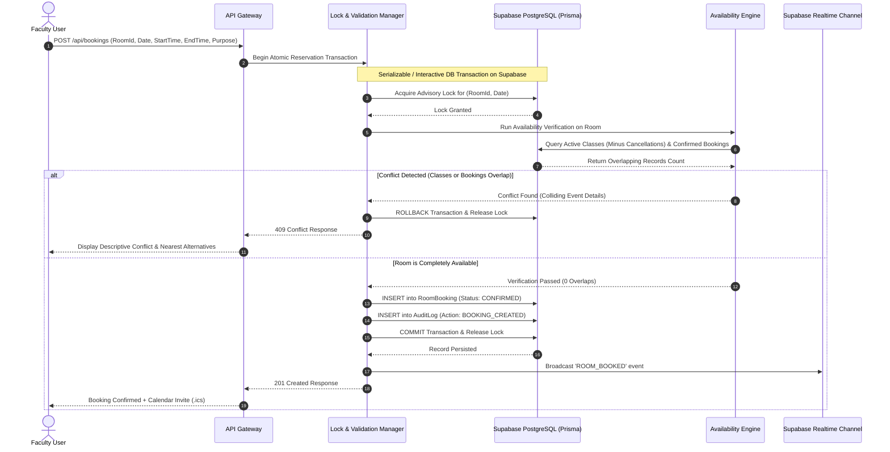
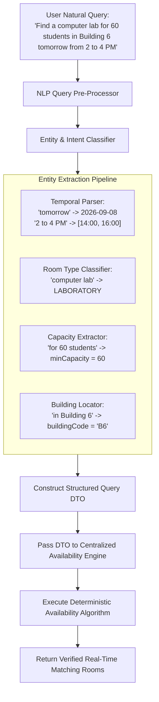
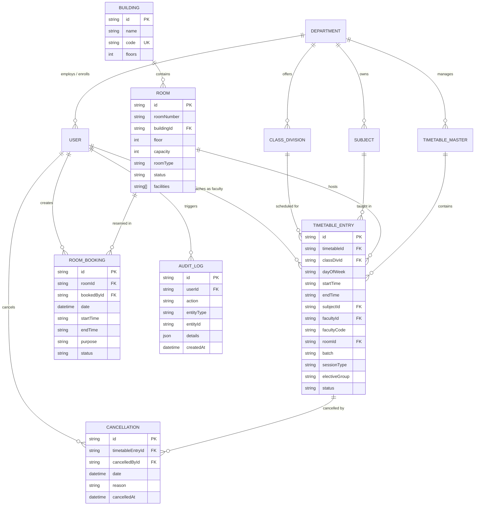
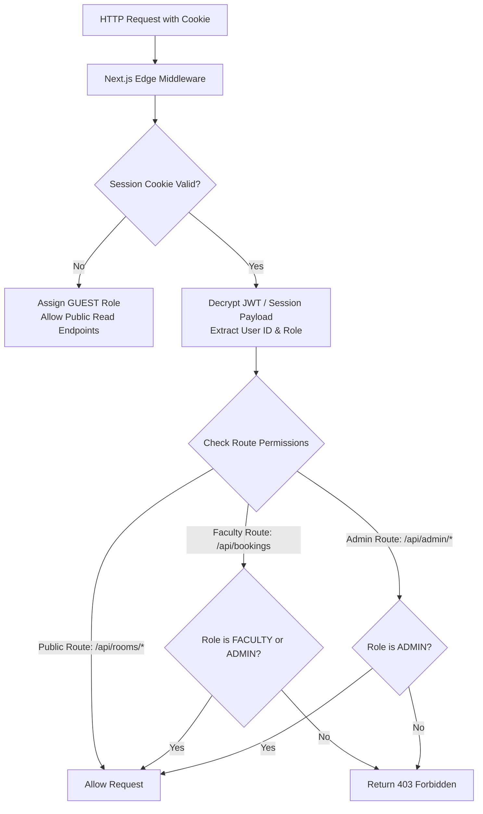

# Smart Classroom & Lab Availability System
## System Architecture & Technical Design Specification

---

## 1. System Overview & Architectural Topology

The **Smart Classroom & Lab Availability System** is designed as a modular, high-throughput, real-time web application built on a modern full-stack TypeScript architecture. It handles concurrent queries, complex multi-division timetable ingestion, real-time status resolution, and race-condition-free temporary room reservations.

### 1.1. High-Level Architectural Flow

```mermaid
flowchart TB
    subgraph ClientLayer ["Client / Presentation Layer (Next.js 14+ / React / Tailwind CSS)"]
        UI_Student["Student Portal\n- Available Now\n- Room Search\n- Live Timeline"]
        UI_Faculty["Faculty Portal\n- My Schedule\n- 1-Click Cancel\n- Quick Booking"]
        UI_Admin["Admin Control Hub\n- Timetable Ingest\n- Conflict Matrix\n- Infrastructure"]
        UI_NLP["Natural Language\nRoom Finder Bar"]
    end

    subgraph APILayer ["API Gateway & Controller Layer (Next.js App Router / Server Actions)"]
        API_Auth["/api/auth/*\nSession / JWT / RBAC"]
        API_Rooms["/api/rooms/*\nMetadata & Inventory"]
        API_Avail["/api/availability/*\nReal-Time & Future Engine"]
        API_Booking["/api/bookings/*\nAtomic Reservation"]
        API_Cancel["/api/cancellations/*\nLecture Cancellation"]
        API_Ingest["/api/timetable/import\nMulti-Format Parser"]
        API_NLP["/api/nlp/search\nEntity Extractor"]
    end

    subgraph ServiceLayer ["Core Service & Business Logic Layer"]
        SRV_Engine["Centralized Availability Engine\n(Interval Overlap & Gap Analyzer)"]
        SRV_Ingest["Universal Timetable Normalizer (UTEN)\n(Grid De-multiplexer & Batch Splitter)"]
        SRV_Lock["Advisory Lock & Booking Manager\n(Two-Phase Collision Guard)"]
        SRV_NLP["NLP Parser & Query Builder"]
        SRV_Audit["Audit Log & Event Dispatcher"]
    end

    subgraph DataLayer ["Persistence, Auth & Realtime Layer (Supabase / PostgreSQL)"]
        DB_Supabase[("Supabase Platform\n- Managed PostgreSQL Database\n- Supabase Realtime Channels\n- Row-Level Security (RLS)\n- Connection Pooler (PgBouncer)")]
        DB_Prisma["Prisma ORM & Supabase Client\n(Type-Safe Access & Subscriptions)"]
    end

    ClientLayer -->|HTTPS / JSON / Server Actions| APILayer
    APILayer --> ServiceLayer
    ServiceLayer --> DB_Prisma
    DB_Prisma --> DB_Supabase
```



---

## 2. Technology Stack & Component Rationale



| Layer | Technology | Technical Rationale |
|---|---|---|
| **Framework** | Next.js 14+ (App Router) | Unified TypeScript full-stack environment, Server Components for high-performance rendering, Server Actions for mutations. |
| **Language** | TypeScript (Strict Mode) | End-to-end type safety spanning DB models, API payloads, and UI props. Eliminates null/undefined runtime crashes. |
| **Styling & UI** | Tailwind CSS + Shadcn UI | Utility-first CSS, responsive layout grids, dark/light theme tokens, and accessible interactive primitives (modals, dropdowns, calendars). |
| **Data Access** | Prisma ORM & `@supabase/supabase-js` | Automated migrations, type-safe query building, relational joins, and strict schema validation with Supabase connection pooling. |
| **Database** | Supabase (PostgreSQL 15+) | Enterprise-grade managed PostgreSQL with connection pooling, Row Level Security (RLS), ACID transactions, and Realtime WebSocket engine. |
| **Validation** | Zod | Runtime schema validation for all API inputs, query params, and imported timetable datasets. |
| **Authentication** | Supabase Auth | Secure, session-based & JWT authentication with role claims (`STUDENT`, `FACULTY`, `ADMIN`) and RLS enforcement. |
| **Testing** | Vitest + Playwright | Ultra-fast unit testing for the availability algorithm and end-to-end browser testing for critical booking flows. |

---

## 3. Universal Timetable Ingestion Engine Architecture

Real-world institutional timetables (e.g., *PCCOE Class Time Table ACAD/R/10A*) contain multi-batch labs, cross-division electives, multidisciplinary minors, and shared multi-room codes in a single tabular grid.

### 3.1. Ingestion Pipeline & Normalization Flow

```mermaid
flowchart TD
    A[Raw Input File\nCSV / Excel Grid / JSON] --> B[File Pre-Processor & Encoding Check]
    B --> C{Detect Format}

    C -->|Format 1: Flat CSV| D1[CSV Schema Validator\nHeader & Column Matcher]
    C -->|Format 2: Matrix Grid Excel| D2[Matrix Grid De-multiplexer\nDays × Time Slots Extractor]
    C -->|Format 3: JSON Batch| D3[Zod JSON Payload Validator]

    D1 --> E[Unified Timetable Event Normalizer - UTEN]
    D2 --> E
    D3 --> E

    subgraph UTEN ["UTEN Normalization Sub-Modules"]
        E1[Room Code Classifier\n'6201CR' -> CLASSROOM\n'6206LA' -> LABORATORY]
        E2[Multi-Batch Unwrapper\n'IOT B1, B2; CGG B1'\n-> 3 Independent Occupancies]
        E3[Elective Track Resolver\n'PEC-I (A+B), (C+D)'\n-> Cross-Division Parallel Records]
        E4[Multi-Room Splitter\n'6221LA & 6222LA'\n-> Allocates Both Labs]
        E5[Legend Dictionary Resolver\n'PS' -> 'Dr. Priya Surana'\n'TOC' -> 'Theory of Computation']
    end

    E --> UTEN
    UTEN --> F[Pre-Commit Conflict Detector]

    F --> G{Internal Conflicts Found?}
    G -->|Yes| H[Generate Interactive Conflict Report\nShow Overlaps & Missing References]
    G -->|No / Resolved| I[Execute Batch Database Transaction]
    I --> J[Master Timetable Activated & Cache Invalidated]
```

### 3.2. Matrix Cell De-multiplexing Algorithm

When processing a complex matrix cell (e.g., Wednesday 09:00 - 11:00):
`"IOT B1 - (SCK) 6206LA, IOT B2 - (DipaliP) 6208LA, CGG B1 - (PG) 6210LA"`

```
Step 1: Tokenize by comma / semicolon / newline delimiters.
Step 2: For each token, extract:
        - Subject Code: 'IOT', 'CGG'
        - Batch Identifier: 'B1', 'B2'
        - Faculty Initials: 'SCK', 'DipaliP', 'PG'
        - Room Identifier: '6206LA', '6208LA', '6210LA'
Step 3: Resolve Faculty Full Name and Subject Full Name via the sheet's Legend Table.
Step 4: Resolve Room Entity (Building '6', Floor '2', Room '6206', Type 'LABORATORY').
Step 5: Emit 3 discrete TimetableEntry database records tied to the Master Timetable.
```

---

## 4. Centralized Availability Engine Architecture

The Availability Engine is the single source of truth for all room occupancy queries across the entire application.

```mermaid
flowchart TD
    REQ[Client Query: Date D, Time Window [t_start, t_end], Filters] --> INIT[Initialize Availability Engine]
    
    INIT --> D_PARSE[Resolve Date D -> DayOfWeek W\n(e.g., 2026-09-08 -> TUE)]
    
    INIT --> FETCH[Fetch Master Data for Requested Scope]
    
    subgraph DataFetch ["Parallel Data Fetch"]
        F1[All Active Rooms matching\nType, Building, Capacity]
        F2[Scheduled Timetable Entries\nfor DayOfWeek W]
        F3[Active Cancellations\nfor specific Date D]
        F4[Confirmed Room Bookings\nfor specific Date D]
    end

    FETCH --> DataFetch
    DataFetch --> EVAL[Evaluate Room-by-Room Interval Tree]

    subgraph RoomEval ["Room Evaluation Loop (Per Room R)"]
        R1[Filter Timetable Entries for Room R]
        R2[Remove Cancelled Entries on Date D]
        R3[Filter Confirmed Bookings for Room R on Date D]
        R4[Combine Remaining Active Events into Timeline]
        R5[Check Interval Intersection with [t_start, t_end]]
        R6[Compute Temporal Gaps [AvailableFrom, AvailableUntil]]
        R7[Identify Next Scheduled Event]
    end

    EVAL --> RoomEval
    RoomEval --> CLASSIFY{Any Overlapping Event?}

    CLASSIFY -->|No Overlap| RES_AVAIL["Status: AVAILABLE\nCompute Free Duration & Next Event"]
    CLASSIFY -->|Timetable Overlap| RES_OCC["Status: OCCUPIED\nSubject, Class, Faculty, Free After t_end"]
    CLASSIFY -->|Booking Overlap| RES_BOOK["Status: BOOKED\nBooked By, Purpose, Free After t_end"]

    RES_AVAIL --> OUT[Assemble Response Payload]
    RES_OCC --> OUT
    RES_BOOK --> OUT
    OUT --> SEND[Return JSON Response to Client]
```

### 4.1. Mathematical Time-Interval Overlap Logic

Let the requested interval be $Q = [q_s, q_e]$ and any active event interval be $E = [e_s, e_e]$.

$$\text{isOccupied}(Q, E) = (q_s < e_e) \land (q_e > e_s)$$

**Boundary Handling Cases**:
- **Case A (Disjoint Before)**: $q_e \le e_s \implies \text{False}$ (Free)
- **Case B (Disjoint After)**: $q_s \ge e_e \implies \text{False}$ (Free)
- **Case C (Touching Boundary)**: $q_e = e_s$ or $q_s = e_e \implies \text{False}$ (Permitted for back-to-back classes)
- **Case D (Partial / Complete Overlap)**: $q_s < e_e \land q_e > e_s \implies \text{True}$ (Occupied)

### 4.2. Gap & Timeline Calculation Logic

```typescript
interface TimeSlot {
  start: string; // "09:00"
  end: string;   // "10:00"
  type: 'TIMETABLE' | 'BOOKING' | 'CANCELLED' | 'AVAILABLE';
  metadata?: Record<string, unknown>;
}

// Algorithm:
// 1. Sort all active events chronologically by start time.
// 2. Iterate from OperatingDayStart (e.g., "08:00") to OperatingDayEnd (e.g., "18:00").
// 3. For any non-contiguous gap between event[i].end and event[i+1].start:
//    Insert an 'AVAILABLE' TimeSlot.
// 4. Highlight cancelled lectures as 'AVAILABLE' with special flag isCancelledLecture: true.
```

---

## 5. Booking & Collision Management Engine

To eliminate race conditions and double-bookings, the system utilizes a **Two-Phase Atomic Reservation Protocol** with database row-level locking.



---

## 6. Lecture Cancellation & Dynamic Room Release Flow

```mermaid
flowchart LR
    A[Faculty / Admin] -->|1-Click Cancel| B[POST /api/timetable/cancel\n{ entryId, date, reason }]
    B --> C[Validate Ownership via Supabase Auth]
    C --> D[Insert Cancellation Record\nInto Supabase DB]
    D --> E[Update Entry Status for Date D]
    E --> F[Supabase Realtime Broadcast\n'LECTURE_CANCELLED']
    F --> G[Availability Engine Instantly Marks\nRoom as AVAILABLE for that Slot]
    G --> H[Live Student Dashboard & Timeline\nUpdated Instantly via WebSocket]
```

---

## 7. Natural Language Room Search (NLP) Architecture



---

## 8. Relational Database Architecture & ER Diagram



---

## 9. API Specifications & Payload Contracts

### 9.1. Core Endpoints Summary

```
+---------------------------------------------------------------------------------------------------+
| METHOD | ROUTE                            | ACCESS   | DESCRIPTION                                |
+---------------------------------------------------------------------------------------------------+
| POST   | /api/auth/login                  | Public   | Authenticate user & issue session cookie   |
| GET    | /api/auth/me                     | Auth     | Return current authenticated user profile  |
| GET    | /api/rooms                       | Public   | List all rooms with filter parameters      |
| GET    | /api/rooms/:id                   | Public   | Get room details, equipment & day schedule |
| GET    | /api/rooms/availability          | Public   | Query room availability for specific slot  |
| GET    | /api/rooms/:id/timeline          | Public   | Visual timeline intervals for a room       |
| GET    | /api/dashboard/stats             | Public   | Summary metrics (Available now, etc.)      |
| POST   | /api/search/natural-language     | Public   | NLP query translated to available rooms    |
| GET    | /api/faculty/my-schedule         | Faculty  | Today's personal timetable for faculty     |
| POST   | /api/timetable/cancel            | Faculty  | Cancel lecture entry (releases room)       |
| POST   | /api/bookings                    | Faculty  | Create temporary room reservation          |
| DELETE | /api/bookings/:id                | Faculty  | Release / cancel an active booking         |
| POST   | /api/admin/timetable/import      | Admin    | Bulk ingest CSV / Excel timetable matrix   |
| GET    | /api/admin/conflicts             | Admin    | Scan system-wide timetable collisions      |
| GET    | /api/admin/audit-logs            | Admin    | Filter and inspect system audit trail      |
+---------------------------------------------------------------------------------------------------+
```

### 9.2. Availability Query API Contract

**Request:** `GET /api/rooms/availability?date=2026-09-08&startTime=14:00&endTime=16:00&roomType=CLASSROOM&minCapacity=50&buildingCode=B6`

**Response (`200 OK`):**
```json
{
  "query": {
    "date": "2026-09-08",
    "dayOfWeek": "TUE",
    "startTime": "14:00",
    "endTime": "16:00",
    "roomType": "CLASSROOM",
    "minCapacity": 50,
    "buildingCode": "B6"
  },
  "summary": {
    "totalMatchingRooms": 14,
    "availableCount": 9,
    "occupiedCount": 5
  },
  "rooms": [
    {
      "id": "rm-6204",
      "roomNumber": "6204CR",
      "building": "Building 6",
      "floor": 2,
      "capacity": 60,
      "roomType": "CLASSROOM",
      "status": "AVAILABLE",
      "availableFrom": "13:10",
      "availableUntil": "16:10",
      "nextEvent": {
        "title": "TOC*",
        "startTime": "16:10",
        "endTime": "17:10",
        "faculty": "Ms. Harsha Talele"
      },
      "facilities": ["Projector", "AC", "Smart Board"]
    }
  ]
}
```

---

## 10. Security, Authentication & Role-Based Access Control (RBAC)



---

## 11. Scalability, Caching & Performance Architecture

1. **In-Memory Query Memoization**:
   - Master timetable definitions and room metadata are cached in-memory with tag-based invalidation upon any timetable upload, room update, or cancellation.
2. **Database Indexing Strategy**:
   - Composite B-Tree index on `TimetableEntry(dayOfWeek, startTime, endTime)`.
   - Index on `Cancellation(date, timetableEntryId)`.
   - Index on `RoomBooking(roomId, date, startTime, endTime, status)`.
3. **Optimistic UI Updates**:
   - Frontend state updates instantaneously upon 1-click lecture cancellation or booking confirmation, rolling back gracefully if the server returns an error.

---
*System Architecture Specification for the Smart Classroom & Lab Availability System.*
