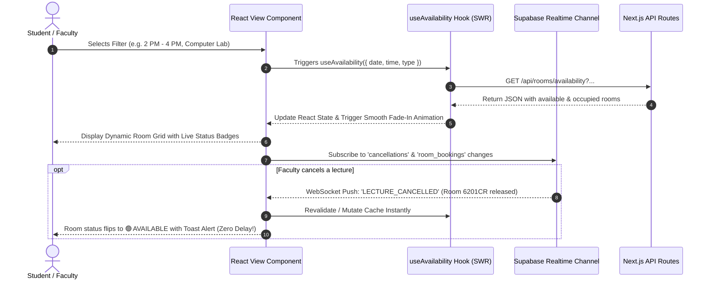

# Smart Classroom & Lab Availability System
## Frontend Architecture, Design System & UI/UX Component Specification

---

## 1. Frontend Architecture & Directory Layout

The frontend is built with **Next.js 14+ (App Router)**, **React 18**, **TypeScript**, **Tailwind CSS**, and **Shadcn UI (Radix Primitives)**. It emphasizes high visual polish, instantaneous responsiveness, and accessible micro-interactions.

### 1.1. Directory Structure

```
frontend/
├── src/
│   ├── app/
│   │   ├── layout.tsx             # Root layout with ThemeProvider & AuthProvider
│   │   ├── page.tsx               # Home & Student Live "Available Now" Dashboard
│   │   ├── (auth)/
│   │   │   ├── login/page.tsx     # Unified Login page (Student, Faculty, Admin)
│   │   │   └── unauthorized/page.tsx # 403 Forbidden page
│   │   ├── search/
│   │   │   └── page.tsx           # Parametric & NLP Room Finder Search page
│   │   ├── rooms/
│   │   │   └── [id]/
│   │   │       └── page.tsx       # Room Details, Live Status & 24h Visual Timeline
│   │   ├── timetable/
│   │   │   └── page.tsx           # Institutional Master Timetable Matrix Viewer
│   │   ├── cancellations/
│   │   │   └── page.tsx           # Real-Time Lecture Cancellation & Room Release Feed
│   │   ├── faculty/
│   │   │   ├── layout.tsx         # Faculty layout with sidebar & role guard
│   │   │   ├── dashboard/page.tsx # Faculty Schedule, 1-Click Cancel & Quick Booking
│   │   │   └── bookings/page.tsx  # My Active & Past Room Bookings Manager
│   │   └── admin/
│   │       ├── layout.tsx         # Admin layout with control center navigation
│   │       ├── dashboard/page.tsx # Master Admin KPI Dashboard
│   │       ├── rooms/page.tsx     # Room & Building Infrastructure CRUD
│   │       ├── timetable/
│   │       │   ├── page.tsx       # Timetable entries manager
│   │       │   └── import/page.tsx# Bulk Timetable Ingest & Conflict Resolver Grid
│   │       ├── users/page.tsx     # Student & Faculty Directory Management
│   │       └── audit-logs/page.tsx# System Activity & Audit Trail Viewer
│   ├── components/
│   │   ├── common/
│   │   │   ├── Navbar.tsx         # Main header with Role switcher & live clock
│   │   │   ├── Sidebar.tsx        # Responsive desktop/mobile navigation sidebar
│   │   │   ├── StatusBadge.tsx    # Standardized color-coded status badges
│   │   │   ├── FacilityPill.tsx   # Amenity badge (Projector, AC, Smart Board)
│   │   │   ├── LiveClock.tsx      # Real-time campus time display with slot sync
│   │   │   └── EmptyState.tsx     # Graceful empty search results with suggestions
│   │   ├── search/
│   │   │   ├── NLPSearchBar.tsx   # Conversational Natural Language Query Bar
│   │   │   ├── FilterDrawer.tsx   # Parametric filter panel (Building, Floor, Type)
│   │   │   └── QuickSlotFilter.tsx# Quick filters (Now, Next Hour, Afternoon)
│   │   ├── rooms/
│   │   │   ├── RoomCard.tsx       # Main room card with countdown & action button
│   │   │   ├── RoomGrid.tsx       # Responsive CSS grid for room listings
│   │   │   ├── RoomTimeline.tsx   # Interactive 24-hr visual Gantt-style timeline
│   │   │   └── RoomQuickModal.tsx # Rapid preview modal with live schedule
│   │   ├── booking/
│   │   │   ├── QuickBookingModal.tsx # Conflict-aware reservation dialog
│   │   │   └── ConflictAlertModal.tsx # Explains collision & suggests free rooms
│   │   ├── cancellation/
│   │   │   ├── CancelLectureModal.tsx # 1-Click lecture cancellation with reason
│   │   │   └── CancellationFeedCard.tsx # Real-time released room alert card
│   │   ├── timetable/
│   │   │   ├── TimetableMatrix.tsx# Full weekly Day × Time Slot interactive grid
│   │   │   ├── MatrixCell.tsx     # Handles multi-batch labs & parallel electives
│   │   │   └── IngestPreviewGrid.tsx # Pre-commit timetable upload conflict table
│   │   └── ui/                    # Shadcn UI primitives (Button, Dialog, Select, etc.)
│   ├── hooks/
│   │   ├── useAvailability.ts     # SWR / React Query hook for availability data
│   │   ├── useRoomTimeline.ts     # Fetches day timeline with optimistic caching
│   │   ├── useSupabaseRealtime.ts # Supabase Realtime subscription for instant cancellations & bookings
│   │   ├── useNLPSearch.ts        # Debounced natural language query hook
│   │   ├── useAuth.ts             # Supabase Auth session, role state & auth actions
│   │   └── useLiveTimer.ts        # Auto-ticks every 30 seconds for live countdowns
│   ├── lib/
│   │   ├── api.ts                 # Axios / Fetch client with interceptors
│   │   ├── supabase.ts            # Supabase Browser Client (@supabase/ssr / @supabase/supabase-js)
│   │   ├── utils.ts               # Tailwind class merging (clsx + twMerge)
│   │   └── date-helpers.ts        # Frontend date and 12-hr time formatters
│   ├── types/
│   │   ├── ui.types.ts            # Component prop types and theme tokens
│   │   └── api.types.ts           # DTOs synced with backend schema
│   └── styles/
│       └── globals.css            # Tailwind directives, animations & theme vars
```

---

## 2. Design System, Color Tokens & Visual Language

The design system is crafted to convey an **academic, ultra-modern, and clean** atmosphere with high visual clarity.

### 2.1. Color Palette & Status Design Tokens

| Token | Hex Value | Visual Appearance | Used For |
|---|---|---|---|
| `--status-available` | `#10B981` (Emerald 500) | 🟢 Vibrant Green | Room is free right now or for the entire requested window |
| `--status-occupied` | `#EF4444` (Rose 500) | 🔴 Bright Red | Scheduled timetable lecture or lab is currently in session |
| `--status-booked` | `#F59E0B` (Amber 500) | 🟡 Warm Amber | Temporary faculty booking/reservation is active |
| `--status-cancelled` | `#8B5CF6` (Violet 500) | 🟣 Violet / Dashed | Scheduled lecture cancelled; room is released for open study |
| `--status-maintenance`| `#6B7280` (Gray 500) | ⚪ Slate Gray | Room is offline for maintenance or examination |

### 2.2. Typography & Hierarchy
- **Primary Font Family**: `Inter`, `Plus Jakarta Sans`, or `Outfit` via `next/font/google`.
- **Display Headings**: `font-bold tracking-tight text-slate-900 dark:text-white`
- **Metric Numbers**: `font-extrabold font-mono text-2xl`
- **Badges & Tags**: `font-medium text-xs uppercase tracking-wider`

---

## 3. Core Pages & Layouts

```mermaid
graph TD
    A[Root Layout: Navbar + Live Campus Clock + Auth] --> B[Home / Student Dashboard]
    A --> C[Search & Filter Hub]
    A --> D[Room Details & Timeline]
    A --> E[Master Timetable Matrix]
    A --> F[Cancellation Feed]
    A --> G[Faculty Portal]
    A --> H[Admin Control Center]

    subgraph "Student Features"
        B --> B1[Available Now KPI Cards]
        B --> B2[Quick NLP Search Bar]
        B --> B3[Live Room Grid]
        C --> C1[Multi-Parametric Filter Drawer]
        D --> D1[Interactive 24-hr Timeline]
    end

    subgraph "Faculty Features"
        G --> G1[Today's Teaching Schedule]
        G --> G2[1-Click Lecture Cancellation Modal]
        G --> G3[Instant Room Booking Dialog]
        G --> G4[Booking Collision Explainer]
    end

    subgraph "Admin Features"
        H --> H1[Bulk Timetable Upload]
        H --> H2[Pre-Commit Conflict Matrix]
        H --> H3[Room & Building CRUD]
        H --> H4[Audit History Explorer]
    end
```



---

## 4. Key UI Components & Implementation Blueprints

### 4.1. Status Badge Component (`StatusBadge.tsx`)

```tsx
// frontend/src/components/common/StatusBadge.tsx
import React from 'react';
import { cn } from '@/lib/utils';

export type RoomStatusType = 'AVAILABLE' | 'OCCUPIED' | 'BOOKED' | 'CANCELLED' | 'MAINTENANCE';

interface StatusBadgeProps {
  status: RoomStatusType;
  className?: string;
  showDot?: boolean;
}

const statusConfig: Record<RoomStatusType, { label: string; bg: string; text: string; dot: string }> = {
  AVAILABLE: {
    label: 'Available Now',
    bg: 'bg-emerald-50 text-emerald-700 border-emerald-200 dark:bg-emerald-950/40 dark:text-emerald-300 dark:border-emerald-800',
    dot: 'bg-emerald-500 animate-pulse'
  },
  OCCUPIED: {
    label: 'Occupied',
    bg: 'bg-rose-50 text-rose-700 border-rose-200 dark:bg-rose-950/40 dark:text-rose-300 dark:border-rose-800',
    dot: 'bg-rose-500'
  },
  BOOKED: {
    label: 'Booked',
    bg: 'bg-amber-50 text-amber-700 border-amber-200 dark:bg-amber-950/40 dark:text-amber-300 dark:border-amber-800',
    dot: 'bg-amber-500'
  },
  CANCELLED: {
    label: 'Class Cancelled (Free)',
    bg: 'bg-violet-50 text-violet-700 border-violet-200 dark:bg-violet-950/40 dark:text-violet-300 dark:border-violet-800',
    dot: 'bg-violet-500'
  },
  MAINTENANCE: {
    label: 'Maintenance',
    bg: 'bg-slate-100 text-slate-700 border-slate-200 dark:bg-slate-800 dark:text-slate-300 dark:border-slate-700',
    dot: 'bg-slate-400'
  }
};

export const StatusBadge: React.FC<StatusBadgeProps> = ({ status, className, showDot = true }) => {
  const config = statusConfig[status] || statusConfig.AVAILABLE;

  return (
    <span className={cn(
      'inline-flex items-center gap-1.5 px-2.5 py-1 rounded-full text-xs font-semibold border shadow-sm transition-all',
      config.bg,
      className
    )}>
      {showDot && <span className={cn('w-2 h-2 rounded-full', config.dot)} />}
      {config.label}
    </span>
  );
};
```

---

### 4.2. Interactive Room Timeline Component (`RoomTimeline.tsx`)

A visual 24-hour horizontal bar displaying all slots, highlighting classes, cancelled lectures, manual bookings, and available gaps.

```tsx
// frontend/src/components/rooms/RoomTimeline.tsx
'use client';

import React from 'react';
import { cn } from '@/lib/utils';
import { Clock, CheckCircle, XCircle, AlertCircle } from 'lucide-react';

export interface TimelineSlot {
  id: string;
  startTime: string; // "09:00"
  endTime: string;   // "10:00"
  startMinutes: number;
  endMinutes: number;
  type: 'AVAILABLE' | 'TIMETABLE' | 'BOOKING' | 'CANCELLED';
  title: string;
  subtitle?: string;
  facultyName?: string;
}

interface RoomTimelineProps {
  roomNumber: string;
  slots: TimelineSlot[];
  dayStart?: number; // default 480 (08:00 AM)
  dayEnd?: number;   // default 1080 (06:00 PM)
  onSlotClick?: (slot: TimelineSlot) => void;
}

export const RoomTimeline: React.FC<RoomTimelineProps> = ({
  roomNumber,
  slots,
  dayStart = 480,
  dayEnd = 1080,
  onSlotClick
}) => {
  const totalDuration = dayEnd - dayStart;

  return (
    <div className="w-full bg-white dark:bg-slate-900 rounded-xl p-5 border border-slate-200 dark:border-slate-800 shadow-sm">
      <div className="flex items-center justify-between mb-4">
        <div className="flex items-center gap-2">
          <Clock className="w-5 h-5 text-indigo-600 dark:text-indigo-400" />
          <h3 className="text-base font-bold text-slate-800 dark:text-slate-100">
            Daily Schedule Timeline &bull; {roomNumber}
          </h3>
        </div>
        <div className="flex items-center gap-4 text-xs font-medium text-slate-500">
          <span className="flex items-center gap-1"><span className="w-2.5 h-2.5 rounded bg-emerald-500" /> Free</span>
          <span className="flex items-center gap-1"><span className="w-2.5 h-2.5 rounded bg-rose-500" /> Class</span>
          <span className="flex items-center gap-1"><span className="w-2.5 h-2.5 rounded bg-amber-500" /> Booked</span>
          <span className="flex items-center gap-1"><span className="w-2.5 h-2.5 rounded bg-violet-500" /> Cancelled</span>
        </div>
      </div>

      {/* Hourly Axis Markers */}
      <div className="relative h-6 w-full text-xs text-slate-400 font-mono flex justify-between border-b border-slate-100 dark:border-slate-800 pb-1 mb-2">
        <span>08:00</span>
        <span>10:00</span>
        <span>12:00</span>
        <span>14:00</span>
        <span>16:00</span>
        <span>18:00</span>
      </div>

      {/* Visual Bar Container */}
      <div className="relative h-14 w-full bg-slate-100 dark:bg-slate-800/60 rounded-lg overflow-hidden flex p-1 gap-1">
        {slots.map((slot) => {
          const leftPercent = Math.max(0, ((slot.startMinutes - dayStart) / totalDuration) * 100);
          const widthPercent = Math.min(100, ((slot.endMinutes - slot.startMinutes) / totalDuration) * 100);

          const typeStyles = {
            AVAILABLE: 'bg-emerald-500/15 border-emerald-500/30 text-emerald-700 dark:text-emerald-300 hover:bg-emerald-500/25',
            TIMETABLE: 'bg-rose-500/20 border-rose-500/40 text-rose-800 dark:text-rose-200 hover:bg-rose-500/30',
            BOOKING: 'bg-amber-500/20 border-amber-500/40 text-amber-800 dark:text-amber-200 hover:bg-amber-500/30',
            CANCELLED: 'bg-violet-500/20 border-violet-500/40 border-dashed text-violet-800 dark:text-violet-200 hover:bg-violet-500/30'
          }[slot.type];

          return (
            <div
              key={slot.id}
              onClick={() => onSlotClick && onSlotClick(slot)}
              style={{ width: `${widthPercent}%` }}
              title={`${slot.title} (${slot.startTime} - ${slot.endTime})`}
              className={cn(
                'h-full rounded-md border flex flex-col justify-center px-2 py-1 cursor-pointer transition-all truncate group shadow-xs',
                typeStyles
              )}
            >
              <div className="text-[11px] font-bold truncate flex items-center gap-1">
                {slot.type === 'AVAILABLE' && <CheckCircle className="w-3 h-3 text-emerald-600 shrink-0" />}
                {slot.type === 'TIMETABLE' && <XCircle className="w-3 h-3 text-rose-600 shrink-0" />}
                {slot.type === 'CANCELLED' && <AlertCircle className="w-3 h-3 text-violet-600 shrink-0" />}
                <span className="truncate">{slot.title}</span>
              </div>
              <div className="text-[10px] font-mono opacity-80 truncate">
                {slot.startTime} - {slot.endTime}
              </div>
            </div>
          );
        })}
      </div>
    </div>
  );
};
```

---

### 4.3. Room Card Component (`RoomCard.tsx`)

```tsx
// frontend/src/components/rooms/RoomCard.tsx
import React from 'react';
import Link from 'next/link';
import { StatusBadge, RoomStatusType } from '@/components/common/StatusBadge';
import { Building2, Users, Layers, ArrowRight, Check, Sparkles } from 'lucide-react';
import { Button } from '@/components/ui/button';

export interface RoomCardData {
  id: string;
  roomNumber: string;
  buildingName: string;
  floor: number;
  capacity: number;
  roomType: 'CLASSROOM' | 'LABORATORY' | 'SEMINAR_HALL';
  status: RoomStatusType;
  availableUntil?: string;
  availableFrom?: string;
  nextEvent?: {
    title: string;
    startTime: string;
    endTime: string;
    facultyName?: string;
  };
  facilities: string[];
}

interface RoomCardProps {
  room: RoomCardData;
  onBookClick?: (room: RoomCardData) => void;
  isFaculty?: boolean;
}

export const RoomCard: React.FC<RoomCardProps> = ({ room, onBookClick, isFaculty }) => {
  return (
    <div className="group relative bg-white dark:bg-slate-900 border border-slate-200 dark:border-slate-800 rounded-2xl p-5 shadow-sm hover:shadow-md hover:border-indigo-200 dark:hover:border-indigo-900/50 transition-all duration-200 flex flex-col justify-between">
      <div>
        {/* Card Header: Room Number & Status */}
        <div className="flex items-start justify-between gap-2 mb-3">
          <div>
            <div className="flex items-center gap-2">
              <h2 className="text-xl font-extrabold text-slate-900 dark:text-white group-hover:text-indigo-600 transition-colors">
                {room.roomNumber}
              </h2>
              <span className="text-xs px-2 py-0.5 rounded-md font-medium bg-slate-100 dark:bg-slate-800 text-slate-600 dark:text-slate-300">
                {room.roomType === 'LABORATORY' ? 'Lab' : 'Classroom'}
              </span>
            </div>
            <div className="flex items-center gap-2 text-xs text-slate-500 mt-1">
              <span className="flex items-center gap-1"><Building2 className="w-3.5 h-3.5" /> {room.buildingName}</span>
              <span>&bull;</span>
              <span className="flex items-center gap-1"><Layers className="w-3.5 h-3.5" /> Floor {room.floor}</span>
            </div>
          </div>
          <StatusBadge status={room.status} />
        </div>

        {/* Dynamic Availability Information Box */}
        <div className="my-3 p-3 rounded-xl bg-slate-50 dark:bg-slate-800/50 border border-slate-100 dark:border-slate-800 text-sm">
          {room.status === 'AVAILABLE' ? (
            <div>
              <div className="flex items-center gap-1.5 text-emerald-600 dark:text-emerald-400 font-semibold text-xs">
                <Check className="w-4 h-4" /> Available for study / use
              </div>
              <div className="text-slate-700 dark:text-slate-200 font-medium text-xs mt-1">
                Free until: <span className="font-bold text-slate-900 dark:text-white">{room.availableUntil || 'End of Day'}</span>
              </div>
              {room.nextEvent && (
                <div className="text-xs text-slate-500 mt-1 truncate">
                  Next: {room.nextEvent.title} ({room.nextEvent.startTime})
                </div>
              )}
            </div>
          ) : (
            <div>
              <div className="text-rose-600 dark:text-rose-400 font-semibold text-xs">
                Currently in session
              </div>
              <div className="text-slate-700 dark:text-slate-200 font-medium text-xs mt-1">
                Available from: <span className="font-bold text-slate-900 dark:text-white">{room.availableFrom || 'TBD'}</span>
              </div>
            </div>
          )}
        </div>

        {/* Room Attributes & Facility Tags */}
        <div className="flex items-center gap-4 text-xs text-slate-600 dark:text-slate-300 mb-4">
          <span className="flex items-center gap-1 font-semibold">
            <Users className="w-4 h-4 text-slate-400" /> {room.capacity} Seats
          </span>
          <div className="flex items-center gap-1 flex-wrap">
            {room.facilities.slice(0, 2).map((facility, idx) => (
              <span key={idx} className="px-2 py-0.5 rounded bg-slate-100 dark:bg-slate-800 text-[11px] font-medium text-slate-600 dark:text-slate-300">
                {facility}
              </span>
            ))}
            {room.facilities.length > 2 && (
              <span className="text-[10px] text-slate-400">+{room.facilities.length - 2} more</span>
            )}
          </div>
        </div>
      </div>

      {/* Card Action Buttons */}
      <div className="flex items-center gap-2 pt-3 border-t border-slate-100 dark:border-slate-800">
        <Link href={`/rooms/${room.id}`} className="w-full">
          <Button variant="outline" size="sm" className="w-full text-xs font-semibold flex items-center justify-center gap-1">
            View Schedule <ArrowRight className="w-3.5 h-3.5" />
          </Button>
        </Link>
        {isFaculty && room.status === 'AVAILABLE' && (
          <Button 
            onClick={() => onBookClick && onBookClick(room)}
            size="sm" 
            className="w-full text-xs font-semibold bg-indigo-600 hover:bg-indigo-700 text-white"
          >
            Quick Book
          </Button>
        )}
      </div>
    </div>
  );
};
```

---

### 4.4. Natural Language Search Bar (`NLPSearchBar.tsx`)

```tsx
// frontend/src/components/search/NLPSearchBar.tsx
'use client';

import React, { useState } from 'react';
import { Sparkles, Search, ArrowRight, Loader2 } from 'lucide-react';
import { Input } from '@/components/ui/input';
import { Button } from '@/components/ui/button';

interface NLPSearchBarProps {
  onSearch: (query: string) => void;
  isLoading?: boolean;
}

export const NLPSearchBar: React.FC<NLPSearchBarProps> = ({ onSearch, isLoading }) => {
  const [query, setQuery] = useState('');

  const handleSearchSubmit = (e: React.FormEvent) => {
    e.preventDefault();
    if (query.trim()) {
      onSearch(query.trim());
    }
  };

  const samplePrompts = [
    "Find a lab for 60 students tomorrow 2 PM to 4 PM",
    "Which classrooms are free right now in Building 6?",
    "Classroom with projector for 50 people after 3 PM"
  ];

  return (
    <div className="w-full max-w-3xl mx-auto">
      <form onSubmit={handleSearchSubmit} className="relative flex items-center">
        <div className="absolute left-4 flex items-center pointer-events-none text-indigo-500">
          <Sparkles className="w-5 h-5 animate-pulse" />
        </div>
        <Input
          type="text"
          value={query}
          onChange={(e) => setQuery(e.target.value)}
          placeholder="Ask in plain English (e.g. 'Find a computer lab for 60 students at 2 PM')..."
          className="w-full pl-12 pr-28 py-6 rounded-2xl bg-white dark:bg-slate-900 border-2 border-indigo-100 dark:border-indigo-950 focus:border-indigo-500 dark:focus:border-indigo-500 text-base shadow-lg transition-all"
        />
        <div className="absolute right-2">
          <Button 
            type="submit" 
            disabled={isLoading || !query.trim()}
            className="rounded-xl px-5 py-5 bg-indigo-600 hover:bg-indigo-700 text-white font-semibold text-sm shadow-md"
          >
            {isLoading ? <Loader2 className="w-4 h-4 animate-spin" /> : <span className="flex items-center gap-1">Search <ArrowRight className="w-4 h-4" /></span>}
          </Button>
        </div>
      </form>

      {/* Suggested Quick Prompt Chips */}
      <div className="flex items-center gap-2 mt-3 overflow-x-auto pb-1 text-xs text-slate-500">
        <span className="font-semibold text-slate-400 shrink-0">Try:</span>
        {samplePrompts.map((prompt, idx) => (
          <button
            key={idx}
            type="button"
            onClick={() => {
              setQuery(prompt);
              onSearch(prompt);
            }}
            className="shrink-0 px-3 py-1 rounded-full bg-slate-100 dark:bg-slate-800 hover:bg-indigo-50 dark:hover:bg-indigo-950/50 hover:text-indigo-600 transition-colors border border-slate-200 dark:border-slate-700"
          >
            &ldquo;{prompt}&rdquo;
          </button>
        ))}
      </div>
    </div>
  );
};
```

---

### 4.5. Timetable Matrix Grid Component (`TimetableMatrix.tsx`)

Renders a weekly Day $\times$ Time slot matrix supporting split-batch practicals, cross-division electives, and multi-room allocations.

```tsx
// frontend/src/components/timetable/TimetableMatrix.tsx
import React from 'react';
import { cn } from '@/lib/utils';
import { ParsedTimetableEntry } from '@/types/api.types';

interface TimetableMatrixProps {
  entries: ParsedTimetableEntry[];
  classDivisionName: string; // e.g. "TY - B"
  timeSlots?: string[];
  days?: ('MON' | 'TUE' | 'WED' | 'THU' | 'FRI' | 'SAT')[];
}

export const TimetableMatrix: React.FC<TimetableMatrixProps> = ({
  entries,
  classDivisionName,
  timeSlots = [
    '08:00 - 09:00',
    '09:00 - 10:00',
    '10:00 - 11:00',
    '11:10 - 12:10',
    '12:10 - 01:10',
    '02:10 - 03:10',
    '03:10 - 04:10',
    '04:10 - 05:10',
    '05:10 - 06:10'
  ],
  days = ['MON', 'TUE', 'WED', 'THU', 'FRI', 'SAT']
}) => {
  return (
    <div className="w-full overflow-x-auto rounded-2xl border border-slate-200 dark:border-slate-800 bg-white dark:bg-slate-900 shadow-sm">
      <div className="p-4 border-b border-slate-200 dark:border-slate-800 flex justify-between items-center">
        <h3 className="text-lg font-extrabold text-slate-800 dark:text-white">
          Class Master Timetable &bull; {classDivisionName}
        </h3>
        <span className="text-xs font-mono px-2.5 py-1 bg-indigo-50 text-indigo-700 dark:bg-indigo-950 dark:text-indigo-300 rounded-md font-semibold">
          AY 2026-2027
        </span>
      </div>

      <table className="w-full border-collapse text-xs">
        <thead>
          <tr className="bg-slate-50 dark:bg-slate-800/80 text-slate-600 dark:text-slate-300 font-bold border-b border-slate-200 dark:border-slate-800">
            <th className="p-3 text-left w-24 border-r border-slate-200 dark:border-slate-800">Day / Time</th>
            {timeSlots.map((slot, idx) => (
              <th key={idx} className="p-3 text-center border-r border-slate-200 dark:border-slate-800 min-w-[140px]">
                {slot}
              </th>
            ))}
          </tr>
        </thead>
        <tbody>
          {days.map((day) => (
            <tr key={day} className="border-b border-slate-100 dark:border-slate-800/60 hover:bg-slate-50/50">
              <td className="p-3 font-extrabold text-slate-700 dark:text-slate-300 bg-slate-50/70 dark:bg-slate-800/40 border-r border-slate-200 dark:border-slate-800">
                {day}
              </td>
              {timeSlots.map((slot, sIdx) => {
                const [sStart] = slot.split(' - ');
                const matching = entries.filter(e => e.dayOfWeek === day && e.startTime.startsWith(sStart.trim()));

                return (
                  <td key={sIdx} className="p-2 border-r border-slate-100 dark:border-slate-800/50 align-top">
                    {matching.length === 0 ? (
                      <span className="text-slate-300 dark:text-slate-700 block text-center py-3">-</span>
                    ) : (
                      <div className="space-y-1.5">
                        {matching.map((item, idx) => (
                          <div 
                            key={idx} 
                            className={cn(
                              'p-2 rounded-lg border text-[11px] leading-tight font-medium',
                              item.sessionType === 'PRACTICAL' 
                                ? 'bg-cyan-50 border-cyan-200 text-cyan-900 dark:bg-cyan-950/40 dark:text-cyan-200 dark:border-cyan-800'
                                : 'bg-indigo-50 border-indigo-200 text-indigo-900 dark:bg-indigo-950/40 dark:text-indigo-200 dark:border-indigo-800'
                            )}
                          >
                            <div className="font-bold flex items-center justify-between">
                              <span>{item.subjectCode}</span>
                              {item.batch && <span className="text-[10px] px-1 bg-white/80 dark:bg-black/40 rounded font-mono">{item.batch}</span>}
                            </div>
                            <div className="text-[10px] opacity-80 mt-0.5">
                              {item.facultyCode && <span>({item.facultyCode}) </span>}
                              <span className="font-extrabold text-slate-900 dark:text-white underline">{item.roomNumber}</span>
                            </div>
                          </div>
                        ))}
                      </div>
                    )}
                  </td>
                );
              })}
            </tr>
          ))}
        </tbody>
      </table>
    </div>
  );
};
```

---

## 5. State Management & Data Fetching Flow

The application uses **SWR / React Query** for client caching combined with **Supabase Realtime WebSockets** for instant push notifications on room status changes.



---

## 6. Responsive Layouts & Accessibility (a11y)

1. **Mobile Bottom Navigation Bar**: On mobile displays ($< 768\text{px}$), the desktop sidebar collapses into a fixed, thumb-friendly bottom navigation bar with icons for *Live Radar*, *Find Room*, *Timetable*, and *Profile*.
2. **Keyboard Accessibility**: All modal dialogs (Quick Booking, Cancel Lecture, Filter Drawer) support full `Escape` key dismissal and focus trapping via Radix Dialog primitives.
3. **Screen Reader Support**: All status dots and badges contain explicit `aria-label` attributes (e.g., `aria-label="Room 6201 is occupied by Machine Learning until 3:10 PM"`).

---
*Frontend Architecture & UI/UX Component Specification for the Smart Classroom & Lab Availability System.*
